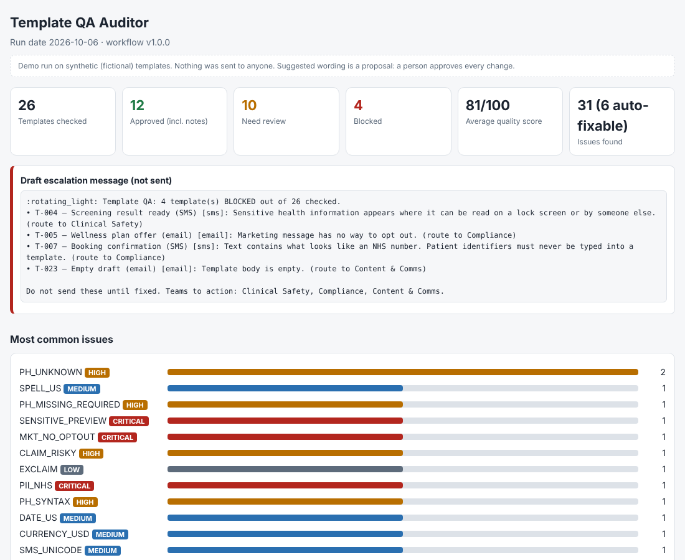

# Template QA Auditor

**An n8n workflow that checks patient-facing SMS and email templates before they are used, and tells you exactly what to fix.**

In the demo run, one click checks 26 sample templates and **blocks 4** before they could reach anyone: a text naming a cancer screening, an NHS number typed into a message, a marketing email with no way to opt out, and an empty draft.

This is an independent demonstration project. All templates, names and numbers are **fictional**. Nothing is ever sent to anyone. It is not affiliated with any company.

## What you get
For every template:
- a status: **APPROVED**, **APPROVED WITH NOTES**, **NEEDS REVIEW** or **BLOCKED**
- a 0 to 100 quality score
- each issue with its severity, a plain-English reason, the exact text found, and the team that should fix it
- suggested corrected wording, for a person to approve
- a list of all issues you can paste into a spreadsheet, and a draft alert message (not sent)

## What it checks
| Area | Examples |
|---|---|
| UK English and wording | US spelling (organize), US dates (10/21/2026), dollar amounts, wordy phrases |
| Placeholders | wrong brackets `{name}`, typos `{{clinicname}}`, missing required ones |
| Compliance and safety | NHS numbers, phone numbers and personal emails typed into text, sensitive health words in SMS, risky claims ("guaranteed"), marketing without opt-out |
| Delivery and style | SMS length and special characters, email subject and sign-off, ALL CAPS, long sentences, extra spaces |

## How to run it
1. In n8n, create an empty workflow.
2. Open `Template_QA_Auditor_n8n.json`, copy everything, click the empty canvas and paste (Ctrl + V). Or use **Import from file**.
3. Click **Execute workflow**. No accounts or API keys are needed.
4. To see the report as a web page: open the node **1b. Report Webhook (GET)**, click **Listen for test event**, and open the Test URL in your browser. A finished example is in `Template_QA_Report_sample.html` (download it and open it in your browser).

To use your own templates, edit the node **3. Load Templates**. All rules live in **2. Load Config**.

## How it was tested
- Executed in a real n8n install (v2.35.7): all 16 steps ran with no errors on 26 sample templates.
- All 25 planted mistakes were caught with the right severity. The 3 clean templates had no false alarms.
- Applying the suggested fixes and re-running removed every issue marked as auto-fixable.
- Odd input (blank fields, numbers instead of text, script tags, a 50,000-character message) did not crash it.
- 2,002 templates processed in under 10 seconds.

## Limits
- It is a rule-based checker, not a clinical or legal sign-off. A person must approve every change.
- The UK spelling list has about 70 words. Add more in **2. Load Config**.
- NHS number detection checks the format only (10 digits), so it can raise a false alarm. That is deliberate: a person decides.

## Built with
n8n and JavaScript (Code nodes). No external services.

Built by Halima Khatoon.
